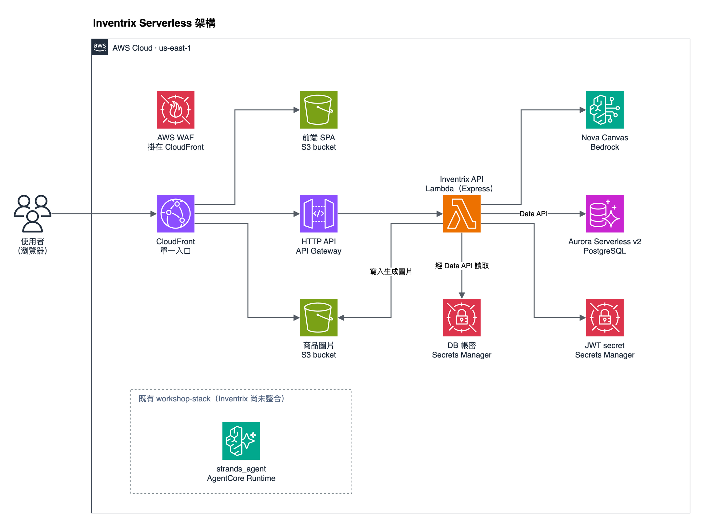

<!-- HEADER STYLE: CLASSIC -->
<div align="center">

# AIDLC WORKSHOP V2

<em>AI 驅動開發，從需求一路走到 Serverless 上線</em>

<!-- BADGES -->


<em>Built with the tools and technologies:</em>


</div>
<br>

---

## Table of Contents

- [Overview](#overview)
- [Architecture](#architecture)
  - [Known Limitations](#known-limitations)
- [Features](#features)
- [Project Structure](#project-structure)
  - [Project Index](#project-index)
- [Getting Started](#getting-started)
  - [Prerequisites](#prerequisites)
  - [Installation](#installation)
  - [Usage](#usage)
- [License](#license)

---

## Overview

這個 repo 是 AI-DLC 工作坊的工作區，包含三個部分：AI-DLC 框架設定（`.claude/`、`aidlc/`）、範例電商應用 Inventrix（`inventrix-code/`），以及把 Inventrix 從單台 EC2 搬到 Serverless 架構的 AWS CDK 程式碼（`infra/`）。

**Why AIDLC Workshop v2?**

這個專案示範如何用 AI-DLC 流程規劃一次實際的架構遷移，並把結果部署到 AWS。主要內容：

- **🔩 結構化的 AI 開發流程：** `.claude/` 內含 AI-DLC 的 agent、stage 規則、hook 與 sensor，每個階段都要人工核准才會往下走。
- **🔌 Serverless 部署：** 前端放在 S3 與 CloudFront，後端是 API Gateway 加 Lambda，資料庫是 Aurora Serverless v2。
- **🧩 本機與雲端共用同一套 SQL：** 本機開發用 PGlite，Lambda 經 Data API 連 Aurora，兩邊執行同一份 PostgreSQL 查詢。
- **🧪 既有資源程式碼化：** 工作坊平台的 `workshop-stack` 以 CDK 載入，`cdk diff` 對線上維持零差異。
- **⚡️ 依用量計費：** Lambda 與 HTTP API 依請求計費，Aurora 閒置 30 分鐘後自動暫停到 0 ACU。
- **🔐 Cognito 帳號：** 以 email 和密碼註冊後即可登入，API Gateway 在請求到達 Lambda 前先驗證 Cognito token。
- **🛡️ 機密不進 repo：** 管理員密碼與資料庫帳密存在 Secrets Manager，匯出的平台 template 裡的測試密碼換成佔位字串。

---

## Architecture



- 使用者只連到 CloudFront。預設路徑讀 S3 上的前端 SPA，`/images/*` 讀商品圖片 bucket，`/api/*` 轉給 API Gateway HTTP API。
- 一個 Lambda 執行整個 Express app，經 RDS Data API 存取 Aurora，所以 Lambda 不必放進 VPC，也不需要 NAT Gateway。
- 帳號存在 Cognito user pool。Lambda 代理 `/api/auth/register` 與 `/api/auth/login`，分別呼叫 Cognito 的 `SignUp` 與 `InitiateAuth`，回傳 Cognito ID token。前端不需要知道 user pool 的設定。
- API Gateway 的 JWT authorizer 驗證 Cognito ID token。登入、註冊、商品瀏覽，以及訪客也能使用的購物車（`/api/cart`）與五子棋（`/api/gomoku`），還有 AI 客服（`POST /api/support/chat`）都是公開路由，由 Lambda 依 token 或 `X-Guest-Id` 辨識使用者；登入使用者的 token 會轉給客服 agent 查詢訂單。其他 `/api/*` 請求沒有有效 token 就回 401，不會呼叫 Lambda。Lambda 內會再驗證一次，並以 Cognito `admin` group 判斷管理員。
- Lambda 呼叫 Data API 時帶上資料庫帳密的 secret ARN。
- WAF 掛在 CloudFront 上，套用 AWS managed rules，並以每 10 分鐘每個 IP 為單位限制請求數：`/api/auth/` 20 次、`/api/support/` 100 次、`/api/` 2000 次。
- AI 客服 Orbit 跑在 Inventrix 自己的 AgentCore Runtime（`inventrix_support`，Node.js 22 加 Strands Agents），模型是 Bedrock 上的 Claude Haiku 4.5。Lambda 以 IAM 呼叫 `InvokeAgentRuntime`，agent 的工具再經 HTTP API 查詢商品；使用者登入時，Lambda 會把 Cognito token 一併交給 agent，agent 才會載入查詢訂單的工具。
- 工作坊既有 `workshop-stack` 的 AgentCore Runtime 維持原狀，Inventrix 不使用它。

可編輯的原始檔是 [inventrix-serverless.drawio](infra/docs/inventrix-serverless.drawio)。架構評估與各項取捨見 [architecture-assessment.md](infra/docs/architecture-assessment.md)。

### Known Limitations

- AI 商品圖生成目前無法使用。程式呼叫的 `amazon.nova-canvas-v1:0` 已停止服務，us-east-1 也沒有其他可用的文字生圖模型。
- AI 客服只在本機與 `cdk synth` 驗證過，AgentCore Runtime 還沒部署到雲端。
- 所有資源都部署在 us-east-1，但客服透過 `us.` 跨區推論設定檔呼叫 Claude Haiku 4.5，推論可能在 us-east-2 或 us-west-2 執行。
- `execute-api` 網域可以直接呼叫，會繞過 WAF；客服 agent 的工具也走這個網域。需要登入的路由仍受 JWT authorizer 保護。
- Cognito ID token 效期 1 天，沒有 refresh 機制，過期後要重新登入。
- 被 API Gateway 擋下的請求回傳 `{"message":"Unauthorized"}`，和 Lambda 回傳的 `{"error": ...}` 格式不同。
- Aurora 暫停後，第一個請求要等 cluster 恢復；Data API client 最多重試 25 秒。
- 這個 repo 沒有自動化測試，驗收方式是 build 通過加上人工檢查。

---

## Features

|     | Component         | Details                                                                                                                                                                                                                                                                                                                                   |
| :-- | :---------------- | :---------------------------------------------------------------------------------------------------------------------------------------------------------------------------------------------------------------------------------------------------------------------------------------------------------------------------------------- |
| ⚙️  | **Architecture**  | <ul><li>CloudFront 以三個 behavior 分流到 S3 與 HTTP API</li><li>Lambda 入口 <code>packages/api/src/lambda.ts</code></li><li>本機入口 <code>packages/api/src/index.ts</code></li></ul>                                                                                                                                                    |
| 🔩  | **Code Quality**  | <ul><li>TypeScript <code>strict</code></li><li>前端 build 先跑 <code>tsc</code></li><li>沒有 ESLint 或 Prettier 設定</li></ul>                                                                                                                                                                                                            |
| 📄  | **Documentation** | <ul><li><code>infra/docs/architecture-assessment.md</code></li><li>draw.io 架構圖與證據 JSON</li><li>AI-DLC 產出的需求與 codekb 在 <code>aidlc/spaces/default/</code></li></ul>                                                                                                                                                           |
| 🔌  | **Integrations**  | <ul><li>RDS Data API（<code>ExecuteStatement</code>、transaction）</li><li>S3 <code>PutObject</code> 寫入生成圖片</li><li>Bedrock <code>InvokeModel</code></li><li>Cognito <code>SignUp</code>、<code>InitiateAuth</code></li><li>AgentCore <code>InvokeAgentRuntime</code></li></ul>                                                     |
| 🧩  | **Modularity**    | <ul><li>pnpm monorepo：<code>packages/api</code>、<code>packages/frontend</code>、<code>packages/support-agent</code></li><li>資料層共用 <code>Database</code> 介面，有 Data API 與 PGlite 兩個實作</li></ul>                                                                                                                             |
| ⚡️  | **Performance**   | <ul><li>SPA 與圖片走 <code>CACHING_OPTIMIZED</code></li><li><code>/api/*</code> TTL 0，<code>Authorization</code> 納入 cache key</li></ul>                                                                                                                                                                                                |
| 🛡️  | **Security**      | <ul><li>S3 bucket 不公開，只允許 CloudFront OAC 讀取</li><li>WAF managed rules 與速率限制</li><li>API Gateway JWT authorizer，Lambda 內以 <code>aws-jwt-verify</code> 再驗證</li><li>管理員密碼由 Secrets Manager 產生</li></ul>                                                                                                          |
| 📦  | **Dependencies**  | <ul><li><code>aws-cdk-lib</code>、<code>express</code>、<code>aws-jwt-verify</code></li><li><code>@electric-sql/pglite</code>、<code>@codegenie/serverless-express</code></li><li><code>@strands-agents/sdk</code>、<code>zod</code></li><li><code>react</code>、<code>vite</code>、<code>tailwindcss</code>、<code>gsap</code></li></ul> |
| 🚀  | **Scalability**   | <ul><li>HTTP API stage throttle：rate 50、burst 100</li><li>Aurora Serverless v2：0 至 2 ACU</li></ul>                                                                                                                                                                                                                                    |

---

## Project Structure

```sh
AIDLC Workshop v2/
├── .claude/
│   ├── agents/
│   │   ├── aidlc-architect-agent.md
│   │   ├── aidlc-architecture-reviewer-agent.md
│   │   ├── aidlc-aws-platform-agent.md
│   │   ├── aidlc-compliance-agent.md
│   │   ├── aidlc-composer-agent.md
│   │   └── ... (9 more)
│   ├── aidlc-common/
│   │   ├── protocols/
│   │   │   ├── stage-definition.md
│   │   │   ├── stage-protocol-checkpoint.md
│   │   │   ├── stage-protocol-collaborators.md
│   │   │   ├── stage-protocol-construction.md
│   │   │   ├── stage-protocol-ensemble.md
│   │   │   └── ... (12 more)
│   │   ├── stages/
│   │   │   ├── construction/
│   │   │   │   ├── build-and-test.md
│   │   │   │   ├── ci-pipeline.md
│   │   │   │   ├── code-generation.md
│   │   │   │   ├── functional-design.md
│   │   │   │   ├── infrastructure-design.md
│   │   │   │   └── ... (2 more)
│   │   │   ├── ideation/
│   │   │   │   ├── approval-handoff.md
│   │   │   │   ├── feasibility.md
│   │   │   │   ├── intent-capture.md
│   │   │   │   ├── market-research.md
│   │   │   │   ├── rough-mockups.md
│   │   │   │   └── ... (2 more)
│   │   │   ├── inception/
│   │   │   │   ├── contract-design.md
│   │   │   │   ├── delivery-planning.md
│   │   │   │   ├── domain-design.md
│   │   │   │   ├── practices-discovery.md
│   │   │   │   ├── refined-mockups.md
│   │   │   │   └── ... (4 more)
│   │   │   ├── initialization/
│   │   │   │   ├── state-init.md
│   │   │   │   ├── workspace-detection.md
│   │   │   │   └── workspace-scaffold.md
│   │   │   └── operation/
│   │   │       ├── deployment-execution.md
│   │   │       ├── deployment-pipeline.md
│   │   │       ├── environment-provisioning.md
│   │   │       ├── feedback-optimization.md
│   │   │       ├── incident-response.md
│   │   │       └── ... (2 more)
│   │   └── conductor.md
│   ├── hooks/
│   │   ├── aidlc-continue-workflow.ts
│   │   ├── aidlc-deliver-stage-rules.ts
│   │   ├── aidlc-fold-usage.ts
│   │   ├── aidlc-log-subagent.ts
│   │   ├── aidlc-plan-approval-guard.ts
│   │   └── ... (15 more)
│   ├── knowledge/
│   │   ├── aidlc-architect-agent/
│   │   │   ├── adr-template.md
│   │   │   ├── architecture-guide.md
│   │   │   ├── architecture-patterns.md
│   │   │   ├── ddd-patterns.md
│   │   │   ├── nfr-design-guide.md
│   │   │   └── ... (1 more)
│   │   ├── aidlc-architecture-reviewer-agent/
│   │   │   └── reviewing.md
│   │   ├── aidlc-aws-platform-agent/
│   │   │   ├── cdk-best-practices.md
│   │   │   ├── cost-optimization-patterns.md
│   │   │   ├── infrastructure-guide.md
│   │   │   └── well-architected-framework.md
│   │   ├── aidlc-compliance-agent/
│   │   │   └── regulatory-frameworks.md
│   │   ├── aidlc-composer-agent/
│   │   │   └── composing.md
│   │   └── ... (10 more)
│   ├── rules/
│   │   └── aidlc.md
│   └── ... (8 more)
├── aidlc/
│   └── spaces/
│       └── default/
│           ├── intents/
│           │   └── intents.json
│           └── memory/
│               ├── org.md
│               ├── project.md
│               └── team.md
├── infra/
│   ├── bin/
│   │   └── infra.ts
│   ├── lambda/
│   │   ├── admin-user/
│   │   └── pre-sign-up/
│   ├── lib/
│   │   ├── inventrix-stack.ts
│   │   ├── redactions.ts
│   │   └── workshop-stack.ts
│   ├── scripts/
│   │   ├── export-live-template.ts
│   │   └── with-live-password.sh
│   ├── templates/
│   │   └── workshop-stack.template.json
│   ├── .gitignore
│   └── ... (4 more)
├── inventrix-code/
│   ├── packages/
│   │   ├── api/
│   │   │   ├── src/
│   │   │   │   ├── app.ts
│   │   │   │   ├── cognito.ts
│   │   │   │   ├── http.ts
│   │   │   │   ├── index.ts
│   │   │   │   ├── lambda.ts
│   │   │   │   └── users.ts
│   │   │   ├── package.json
│   │   │   └── tsconfig.json
│   │   ├── frontend/
│   │   │   ├── src/
│   │   │   │   ├── App.tsx
│   │   │   │   ├── index.css
│   │   │   │   └── main.tsx
│   │   │   ├── index.html
│   │   │   ├── package.json
│   │   │   ├── tsconfig.json
│   │   │   ├── tsconfig.node.json
│   │   │   └── ... (1 more)
│   │   └── support-agent/
│   │       ├── src/
│   │       │   ├── agent.ts
│   │       │   ├── main.ts
│   │       │   ├── tools.ts
│   │       │   └── ... (3 more)
│   │       ├── package.json
│   │       └── tsconfig.json
│   ├── .gitignore
│   ├── deploy.sh
│   ├── destroy.sh
│   ├── LICENSE
│   └── ... (4 more)
├── .gitignore
└── ... (6 more)
```

### Project Index

<details open>
	<summary><b><code>inventrix-code/packages/api/src/</code></b></summary>
	<table>
	<tr><th>File</th><th>Summary</th></tr>
	<tr><td><a href="inventrix-code/packages/api/src/app.ts">app.ts</a></td><td>組裝 Express app，掛上 auth、products、orders、analytics、gomoku、cart、support 七組 route 與集中的錯誤處理。也負責啟動前的準備：讀取 Cognito 設定、建立資料庫連線、建立 schema 並 seed。本機 server 與 Lambda 共用這一份 app。</td></tr>
	<tr><td><a href="inventrix-code/packages/api/src/lambda.ts">lambda.ts</a></td><td>Lambda 的進入點。第一次被呼叫時完成啟動準備，再把 API Gateway 的事件交給 Express 處理；準備失敗時，下一次呼叫會重新嘗試，不會沿用失敗的狀態。</td></tr>
	<tr><td><a href="inventrix-code/packages/api/src/index.ts">index.ts</a></td><td>本機開發用的 HTTP server。在 3000 port 提供 API，並從 <code>public/images</code> 直接提供商品圖片，讓 Vite 的 proxy 可以轉送 <code>/api</code> 與 <code>/images</code>。</td></tr>
	<tr><td><a href="inventrix-code/packages/api/src/db/dataApi.ts">db/dataApi.ts</a></td><td>透過 RDS Data API 存取 Aurora 的資料庫實作。把位置參數轉成 Data API 的具名參數、支援 transaction，並在 Aurora 自動暫停後的恢復期間重試請求。</td></tr>
	<tr><td><a href="inventrix-code/packages/api/src/db/pglite.ts">db/pglite.ts</a></td><td>本機開發用的資料庫實作，以 PGlite 在 process 內執行 PostgreSQL，資料存在 <code>.pglite/</code>。時間欄位維持原始字串格式，和 Data API 的回傳一致。</td></tr>
	<tr><td><a href="inventrix-code/packages/api/src/db/schema.ts">db/schema.ts</a></td><td>定義 users、products、orders、order_items、gomoku_games、cart_items 六張表，並在商品表是空的時候 seed 24 項商品。帳號不 seed，users 資料列在第一次登入時建立。以 advisory lock 避免多個 Lambda 同時建立 schema 或重複 seed。</td></tr>
	<tr><td><a href="inventrix-code/packages/api/src/routes/orders.ts">routes/orders.ts</a></td><td>訂單的查詢、建立與狀態更新。建立訂單時鎖住商品列、檢查並扣減庫存、計算 10% GST，全部在同一個 transaction 內完成；庫存不足時整筆 rollback 並回傳 400。</td></tr>
	<tr><td><a href="inventrix-code/packages/api/src/services/imageGenerator.ts">services/imageGenerator.ts</a></td><td>呼叫 Bedrock 生成商品圖片。設定了 <code>IMAGES_BUCKET</code> 時寫進 S3 的 <code>images/</code>，否則寫到本機 <code>public/images</code>；回傳的路徑格式都是 <code>/images/檔名.png</code>。</td></tr>
	<tr><td><a href="inventrix-code/packages/api/src/cognito.ts">cognito.ts</a></td><td>串接 Cognito。註冊呼叫 <code>SignUp</code>，登入呼叫 <code>InitiateAuth</code> 取得 ID token，驗證 token 時用 <code>aws-jwt-verify</code> 檢查簽章、issuer 與 app client。token 的 <code>cognito:groups</code> 含 <code>admin</code> 時角色為管理員。</td></tr>
	<tr><td><a href="inventrix-code/packages/api/src/users.ts">users.ts</a></td><td>把 Cognito 帳號對應到 users 表的整數 id。以 Cognito <code>sub</code> 為鍵，email、名稱與角色跟著 token 更新，訂單仍以整數 <code>user_id</code> 關聯。</td></tr>
	<tr><td><a href="inventrix-code/packages/api/src/routes/support.ts">routes/support.ts</a></td><td>AI 客服的 <code>POST /api/support/chat</code>。檢查 session ID 與最多 20 則對話，登入使用者的 token 會交給 agent。agent 回覆的商品與訂單 ID 再從資料庫查出完整資料；非管理員只會拿到自己的訂單。</td></tr>
	<tr><td><a href="inventrix-code/packages/api/src/services/supportAgent.ts">services/supportAgent.ts</a></td><td>呼叫客服 agent。設定了 <code>SUPPORT_AGENT_RUNTIME_ARN</code> 時以 <code>InvokeAgentRuntime</code> 呼叫 AgentCore，否則呼叫本機的 <code>http://localhost:8080</code>，可用 <code>SUPPORT_AGENT_URL</code> 覆寫。逾時設為 26 秒，留時間給之後的資料庫查詢。</td></tr>
	</table>
</details>

<details open>
	<summary><b><code>inventrix-code/packages/support-agent/src/</code></b></summary>
	<table>
	<tr><th>File</th><th>Summary</th></tr>
	<tr><td><a href="inventrix-code/packages/support-agent/src/main.ts">main.ts</a></td><td>AgentCore Runtime 的 HTTP 介面。在 8080 port 提供 <code>GET /ping</code> 與 <code>POST /invocations</code>，檢查請求格式（上限 128 KB）後交給 agent。</td></tr>
	<tr><td><a href="inventrix-code/packages/support-agent/src/agent.ts">agent.ts</a></td><td>以 Strands Agents 建立客服 agent，模型預設是 Claude Haiku 4.5 的 <code>us.</code> 跨區推論設定檔，可用 <code>SUPPORT_MODEL_ID</code> 覆寫。每次呼叫最多 8 輪、24 秒，回覆固定包含文字、商品 ID、訂單 ID 與建議問題。</td></tr>
	<tr><td><a href="inventrix-code/packages/support-agent/src/tools.ts">tools.ts</a></td><td>agent 可用的工具。<code>search_products</code> 與 <code>get_product</code> 查詢商品；收到 Cognito token 時才加上 <code>list_my_orders</code> 與 <code>get_order</code>，經 HTTP API 查詢使用者自己的訂單。</td></tr>
	</table>
</details>

<details open>
	<summary><b><code>infra/</code></b></summary>
	<table>
	<tr><th>File</th><th>Summary</th></tr>
	<tr><td><a href="infra/bin/infra.ts">bin/infra.ts</a></td><td>CDK app 的進入點，宣告兩個 stack：只用來比對的 <code>workshop-stack</code>，以及 Inventrix 的 <code>inventrix</code>，兩者都固定部署在 us-east-1。</td></tr>
	<tr><td><a href="infra/lib/inventrix-stack.ts">lib/inventrix-stack.ts</a></td><td>Inventrix 的完整雲端架構：isolated VPC 與 Aurora Serverless v2、兩個 S3 bucket、Cognito user pool、Lambda 與 HTTP API、AI 客服的 AgentCore Runtime（由 <code>packages/support-agent</code> 打包）、CloudFront 與 WAF，以及前端和 seed 圖片的上傳。Aurora 刪除時留 snapshot，圖片 bucket、user pool 與 secret 都保留。</td></tr>
	<tr><td><a href="infra/lambda/pre-sign-up/index.mjs">lambda/pre-sign-up/index.mjs</a></td><td>Cognito 的 pre sign-up trigger。自行註冊的帳號直接確認並標記 email 已驗證，所以註冊後不需要收驗證信就能登入。</td></tr>
	<tr><td><a href="infra/lambda/admin-user/index.mjs">lambda/admin-user/index.mjs</a></td><td>部署時建立管理員的 custom resource。從 Secrets Manager 讀取帳號密碼，在 Cognito 建立使用者、設定永久密碼並加進 <code>admin</code> group。</td></tr>
	<tr><td><a href="infra/lib/workshop-stack.ts">lib/workshop-stack.ts</a></td><td>以 <code>CfnInclude</code> 載入工作坊平台的線上 template，保留所有 logical ID。synth 時把佔位字串換回真正的測試密碼，讓合成結果和線上完全一致。</td></tr>
	<tr><td><a href="infra/scripts/export-live-template.ts">scripts/export-live-template.ts</a></td><td>從線上 <code>workshop-stack</code> 匯出原始 template，把寫死的測試密碼換成佔位字串後存進 <code>templates/</code>，讓 template 可以安全地放進 repo。</td></tr>
	</table>
</details>

---

## Getting Started

### Prerequisites

This project requires the following dependencies:

- **Programming Language:** TypeScript（Node.js 22）
- **Package Manager:** pnpm
- **AWS:** AWS CLI 與可用的憑證，只在部署時需要

### Installation

Build AIDLC Workshop v2 from source and install dependencies:

1. **Clone the repository:**

   ```sh
   ❯ git clone https://github.com/tttingzhang999/gc-aidlc-workshop.git
   ```

2. **Navigate to the project directory:**

   ```sh
   ❯ cd gc-aidlc-workshop
   ```

3. **Install the dependencies:**

   ```sh
   ❯ pnpm -C inventrix-code install
   ❯ pnpm -C infra install
   ```

### Usage

**本機開發：**

```sh
❯ export COGNITO_USER_POOL_ID=$(aws cloudformation describe-stacks --stack-name inventrix --query "Stacks[0].Outputs[?OutputKey=='UserPoolId'].OutputValue" --output text)
❯ export COGNITO_CLIENT_ID=$(aws cloudformation describe-stacks --stack-name inventrix --query "Stacks[0].Outputs[?OutputKey=='UserPoolClientId'].OutputValue" --output text)
❯ pnpm -C inventrix-code dev
```

前端跑在 `http://localhost:5173`，API 跑在 3000 port，Vite 會把 `/api` 與 `/images` 轉給 API。AI 客服 agent 跑在 8080 port，API 沒有設定 `SUPPORT_AGENT_RUNTIME_ARN` 時就呼叫它。資料存在 `inventrix-code/packages/api/.pglite/`，第一次啟動時自動建立 schema 並 seed 商品。

本機的註冊與登入也走已部署的 Cognito user pool，所以要先部署過 `inventrix` stack。登入與註冊只需要上面兩個環境變數；`SignUp` 與 `InitiateAuth` 是 Cognito 的公開 API，不需要 AWS 憑證。如果 `.pglite/` 是加入 Cognito 之前建立的，請先刪掉它，讓 API 重新建立 schema。

AI 客服則需要 AWS 憑證：本機的 agent 用你的預設憑證與 region 呼叫 Bedrock 的 Claude Haiku 4.5，region 請設成 `us-east-1`。沒有憑證時，其他功能照常運作，只有客服會回覆錯誤。

**部署到 AWS：**

```sh
❯ cd infra
❯ export AWS_PROFILE=your-profile
❯ scripts/with-live-password.sh cdk bootstrap
❯ pnpm diff
❯ pnpm deploy:inventrix
```

`cdk bootstrap` 只需要在帳號第一次部署前執行一次。`pnpm diff` 會列出 `workshop-stack` 與 `inventrix` 的差異，確認後再部署。`deploy:inventrix` 會先 build 前端，再部署 `inventrix` stack，最後輸出 CloudFront 網址。這些指令都假設帳號上有工作坊的 `workshop-stack`，因為 CDK app 合成時會從它的 output 讀取測試密碼。

部署時會在 Cognito 建立管理員 `admin@inventrix.com`，密碼由 Secrets Manager 產生。用下面的指令讀取：

```sh
❯ aws secretsmanager get-secret-value --secret-id $(aws cloudformation describe-stacks --stack-name inventrix --query "Stacks[0].Outputs[?OutputKey=='AdminSecretArn'].OutputValue" --output text) --query SecretString --output text
```

一般顧客帳號在網站上自行註冊。

**AI-DLC 工作流程：**

在 Claude Code 開啟這個 repo，輸入 `/aidlc` 加上要做的事，例如 `/aidlc 幫商品列表加上分類篩選`。AI-DLC 會依工作規模提出流程，每個階段完成後都會停下來等你核准。

---

## License

AIDLC Workshop v2 採用 MIT No Attribution 授權，詳見 [LICENSE](LICENSE)。
