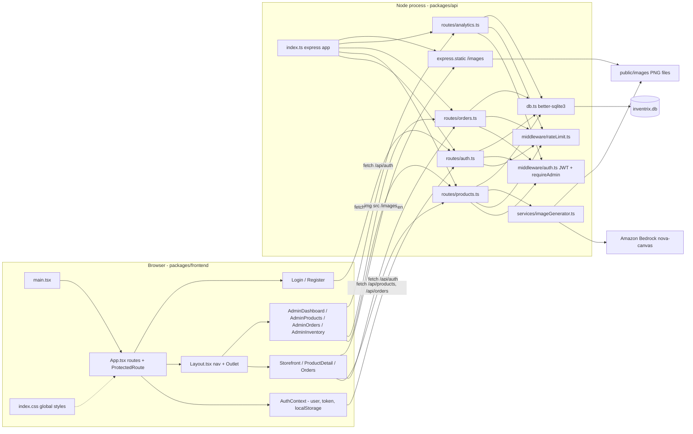
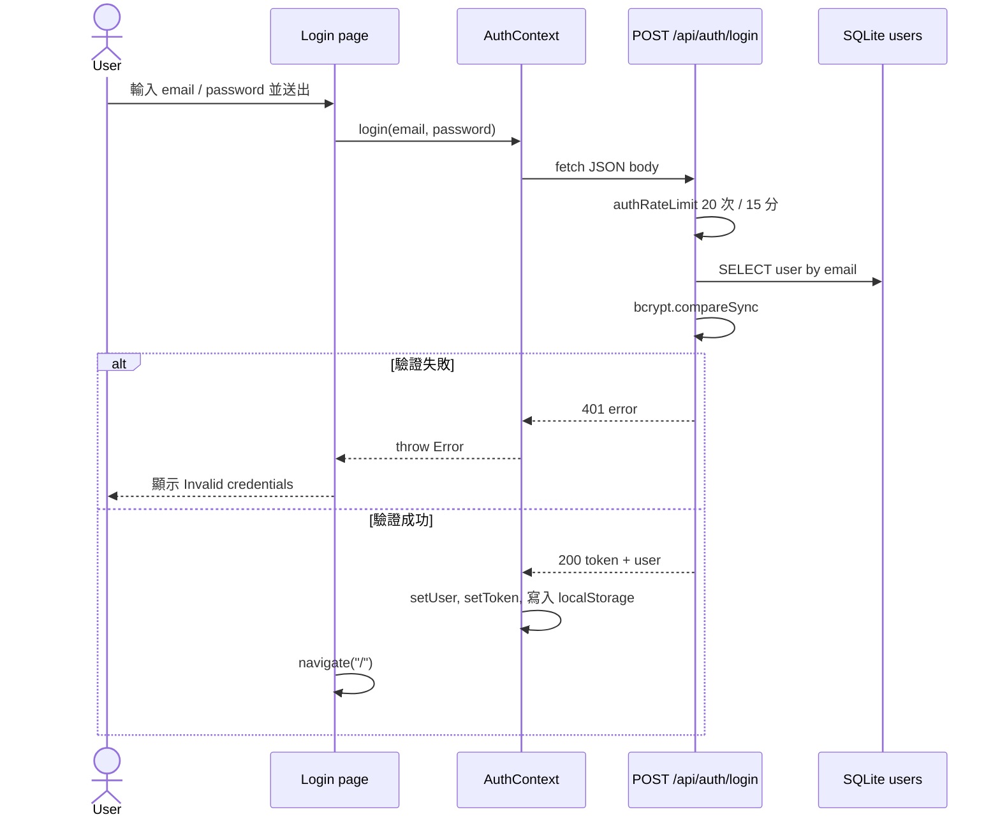
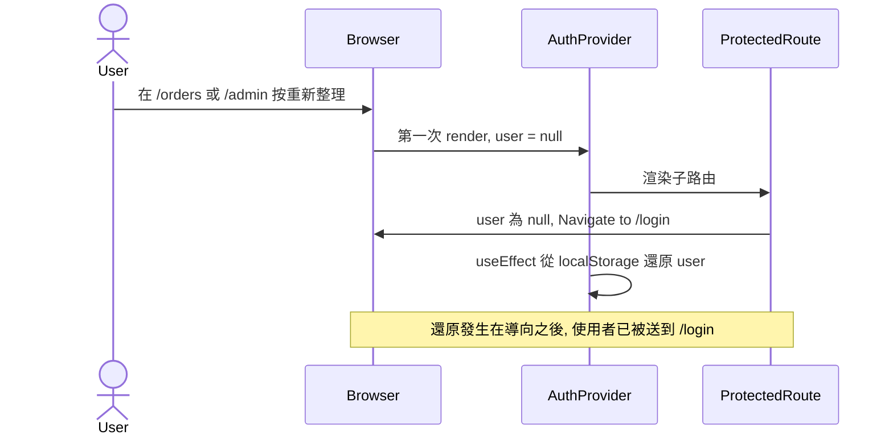
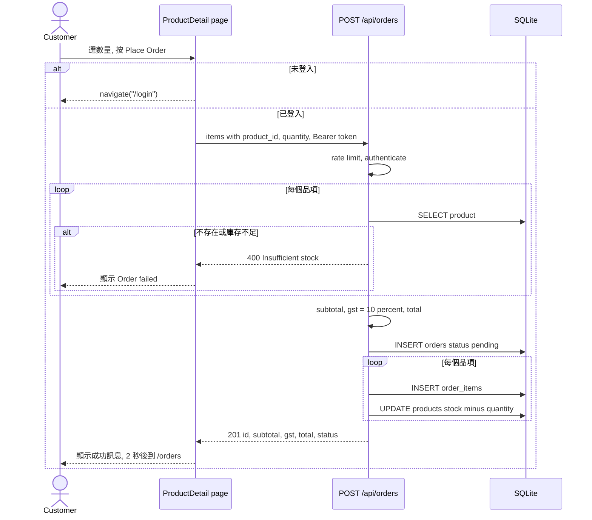
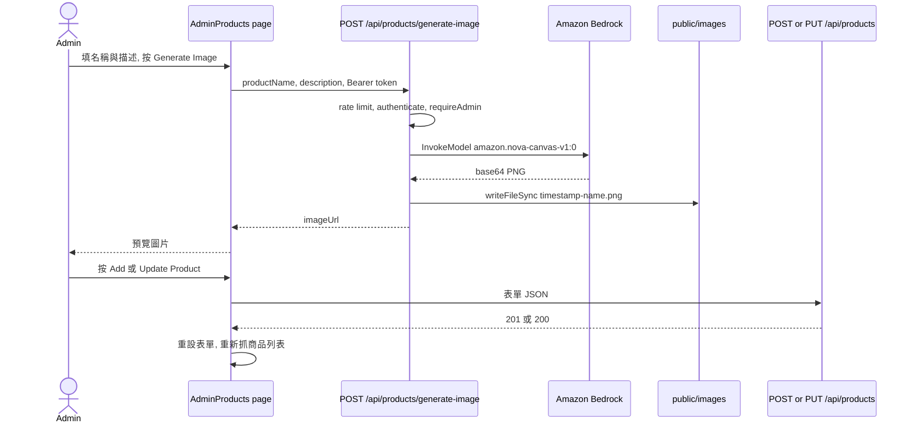
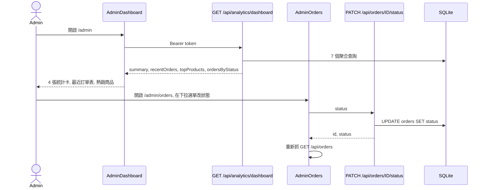

# Architecture

## Architecture Analysis

### System Overview

Inventrix 是一個雙 package 的 pnpm monorepo（`inventrix-code/`）：

- `packages/frontend`：Vite + React 18 的 SPA，用 React Router 6 做 client-side routing，以 React Context 保存登入狀態。
- `packages/api`：Express 4 的 REST API，以 better-sqlite3 存取單一 SQLite 檔 `inventrix.db`，以 JWT 做驗證，並呼叫 Amazon Bedrock 生成商品圖片。

兩者沒有 package 層的相依，只透過 HTTP 溝通。開發時 Vite dev server（port 5173）把 `/api` 與 `/images` proxy 到 API（port 3000）；正式部署時 nginx 在同一台 EC2 上提供前端 `dist/` 靜態檔，並把 `/api`、`/images` 反向代理到由 PM2 管理的 Node process。

### Architectural Style

**單體式（monolith）前後端分離 + 單機部署**。證據：

- 後端是一個 Express process，所有 route 掛在同一個 `app`（`packages/api/src/index.ts`），沒有 service 拆分或訊息佇列。
- 資料存在 process 內嵌的 SQLite 檔，沒有獨立資料庫伺服器。
- 後端分層很薄：route handler 直接寫 SQL（沒有 repository 或 service 層），唯一的 service 是 `imageGenerator.ts`。
- 前端是「page = 資料抓取 + 版面 + 樣式」的扁平結構：每個頁面自己 `fetch`、自己存 state、自己寫 inline style；沒有共用元件、hooks 或 API client。
- 部署為單一 EC2（`deploy.sh`），沒有 IaC、container 或 CI。

### Component Relationships

<!-- Text fallback: In the browser, main.tsx renders App.tsx, which wraps everything in AuthContext and defines routes. Login and Register render alone; every other page renders inside Layout (nav bar + Outlet): customer pages Storefront, ProductDetail, Orders and admin pages AdminDashboard, AdminProducts, AdminOrders, AdminInventory. index.css supplies global styles. On the server, index.ts mounts four routers (auth, products, orders, analytics) plus a static /images handler. Routers use middleware/auth.ts (JWT check, admin check) and middleware/rateLimit.ts, and all query SQLite through db.ts. routes/products.ts also calls services/imageGenerator.ts, which calls Amazon Bedrock and writes PNG files into public/images, the same folder the static handler serves. Pages call the routers with fetch; admin and order calls carry a Bearer token. -->

### Data Flow

1. **讀取商品**：`Storefront` / `ProductDetail` / `AdminProducts` 以未驗證的 `GET /api/products[/:id]` 取得 SQLite 列（snake_case 欄位），直接放進 component state。圖片以 `image_url`（例如 `/images/laptop.png`）作為 ``，由 API 的靜態路由提供。
2. **驗證**：`AuthContext.login/register` 呼叫 `/api/auth/*`，取得 `{ token, user }`，同時寫進 React state 與 `localStorage`（`token`、`user`）。之後每個需要驗證的頁面從 `useAuth()` 取 `token`，自己組 `Authorization: Bearer` header。
3. **下單**：`ProductDetail` 送出 `{ items: [{ product_id, quantity }] }`；後端讀商品、檢查庫存、計算 subtotal / GST / total、寫入 `orders` 與 `order_items`、扣 `products.stock`。
4. **後台寫入**：`AdminProducts` 以 POST / PUT / DELETE 改商品，完成後重新抓整個列表；`AdminOrders` 以 PATCH 改狀態後重新抓列表。沒有樂觀更新。
5. **分析**：`AdminDashboard` 與 `AdminInventory` 呼叫 `/api/analytics/*`，後端用 SQL 聚合即時計算，沒有快取。
6. **AI 圖片**：`AdminProducts` 呼叫 `POST /api/products/generate-image`；後端呼叫 Bedrock、把 base64 PNG 寫到 `public/images/`，回傳相對 URL，前端把它填進表單的 `image_url`。

### Key Design Decisions

| 決策（由程式碼推得） | 影響 |
|------|------|
| SQLite 嵌入式 DB，同步 driver | 部署簡單、零設定；但只能單機、單 process，寫入會阻塞 event loop，無法水平擴展。 |
| route handler 直接寫 SQL，無 service / repository 層 | 程式碼短、易讀；但業務規則（GST、庫存檢查）散在 handler 裡，難以測試，下單流程也沒有 transaction。 |
| JWT（7 天效期）存 `localStorage` | 前端實作簡單、可跨分頁；但易受 XSS 竊取，且沒有 refresh 或撤銷機制。 |
| 前端每頁自管資料抓取與 inline style | 每個頁面自給自足；但視覺語言不一致、重複程式碼多、loading / error / empty 狀態缺失，是本次 UI/UX 重構的主要動機。 |
| Vite proxy / nginx 讓前後端同源 | 前端只用相對路徑 `/api`、`/images`，不需要環境變數設定 API base URL；重構時應保留此慣例。 |
| 圖片存在 API server 本機磁碟 | 不需 S3；但檔案隨 instance 消失，且路徑依賴 `process.cwd()`。 |

### Improvement Opportunities

本節只列與架構相關的項目；完整的品質與技術債清單見 `code-quality-assessment.md`。

- **前端（本 intent 範圍）**：引入一層共用的 API client（統一 base path、Bearer header、`res.ok` 檢查與錯誤轉換），以及共用的 type 定義（`Product`、`Order`、`User`）；建立 design token 與共用元件（Button、Card、Input、Badge、Table、Toast、Skeleton），讓頁面只負責組合；把 auth 還原改為同步初始化或加入 `isLoading` 狀態，修正 `ProtectedRoute` 在重新整理時誤導向的問題。
- **後端（不在本 intent 範圍）**：加入輸入驗證層、把下單包進 `db.transaction`、加入集中式錯誤處理 middleware、移除預設 JWT secret fallback。

## Interaction Diagrams

### 登入並還原 session

<!-- Text fallback: The user submits the Login form. Login calls AuthContext.login, which POSTs to /api/auth/login. The route applies the auth rate limit, looks up the user by email in SQLite and compares the bcrypt hash. On failure it returns 401, AuthContext throws, and Login shows "Invalid credentials". On success it returns a token and user; AuthContext stores both in React state and localStorage, and Login navigates to the storefront. -->

### 重新整理受保護頁面（現有時序問題）

<!-- Text fallback: When a signed-in user reloads /orders or an /admin page, AuthProvider renders first with user = null because the stored user is only restored inside a useEffect. ProtectedRoute sees no user and navigates to /login before the effect runs, so the user lands on the login page even though a valid session exists in localStorage. -->

### 顧客下單

<!-- Text fallback: On ProductDetail the customer picks a quantity and clicks Place Order. If not signed in, the page navigates to /login. Otherwise it POSTs the items with a Bearer token. The API rate-limits and authenticates, then for each item reads the product; a missing product or short stock returns 400 and the page shows "Order failed". Otherwise it computes subtotal, 10 percent GST and total, inserts the order as pending, inserts each order item and decrements stock, and returns 201. The page shows a success message and navigates to /orders after 2 seconds. These writes are not wrapped in a transaction. -->

### Admin 生成商品圖並儲存商品

<!-- Text fallback: The admin fills in name and description and clicks Generate Image. AdminProducts POSTs to /api/products/generate-image with a Bearer token. After rate limit, authentication and admin check, the route calls Bedrock InvokeModel with the Nova Canvas model, receives a base64 PNG, writes it to public/images with a timestamped filename and returns its URL. The page previews it. When the admin saves, the page POSTs (new) or PUTs (edit) the form to /api/products, then resets the form and reloads the product list. -->

### Admin 儀表板與訂單狀態更新

<!-- Text fallback: Opening /admin makes AdminDashboard call GET /api/analytics/dashboard with a Bearer token; the API runs aggregate queries and returns summary, recentOrders, topProducts and ordersByStatus. The page shows four stat cards, a recent-orders table and top products (ordersByStatus is fetched but not shown). On /admin/orders, changing a row's status dropdown sends PATCH /api/orders/:id/status, which updates the row; the page then reloads the full order list. -->
