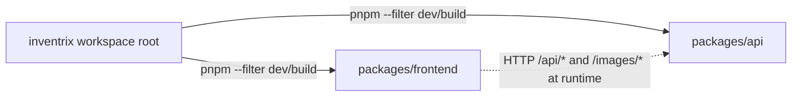

# Dependencies

套件版本清單只記錄在 `technology-stack.md`；本檔記錄相依的方向、用途與風險。

## 內部相依（package 之間）

<!-- Text fallback: The workspace root package.json drives both packages through pnpm --filter scripts (dev, build, start). The frontend has no package-level dependency on the api package; it only calls it over HTTP at runtime through relative /api and /images paths, proxied by Vite in development and by nginx in production. -->

- `frontend` 與 `api` 沒有共用的 package、type 或 schema。前端的 `Product`、`Order`、`User` interface 是手寫的，與後端 SQLite 欄位靠命名慣例對齊（snake_case）。後端改欄位名稱時前端不會在編譯期發現。
- root `package.json` 的 `dev` 以 `&` 同時啟動兩個 package；`build` 先建 api 再建 frontend；`start` 只啟動 api（正式環境前端由 nginx 提供）。

## 模組內相依

後端與前端的檔案層 import 關係記錄在 `code-structure.md` 的 adjacency list；元件層相依記錄在 `component-inventory.md` 每個元件的「相依」欄。重點：

- 後端所有 router 都直接 import `db.ts` 的單例連線，沒有 service 或 repository 介面，無法替換或 mock。
- 前端 8 個檔案依賴 `AuthContext`；`Storefront` 是唯一不需要 auth 的頁面。

## 外部相依（runtime）

| 相依 | 使用者 | 用途 | 風險與備註 |
|------|--------|------|-----------|
| express | api | HTTP server | 4.x 仍維護；`pnpm-workspace.yaml` 以 override 固定 `path-to-regexp` 0.1.13 與 `qs` 6.15.2（推測為安全修補） |
| better-sqlite3 | api | SQLite | native module，需要 build toolchain（`deploy.sh` 安裝 gcc / make）；allowlist 在 `pnpm-workspace.yaml` |
| bcrypt | api | 密碼雜湊 | native module；用同步版 `hashSync` / `compareSync`，會阻塞 event loop |
| jsonwebtoken | api | JWT | secret 有寫死的 fallback（見 `code-quality-assessment.md`） |
| express-rate-limit | api | 限流 | 記憶體 store，重啟即重置，只適用單機 |
| cors | api | CORS | 預設全開 |
| @aws-sdk/client-bedrock-runtime | api | 圖片生成 | 需要 AWS 憑證與 Bedrock 模型存取權；沒有憑證時只有 generate-image 失敗，其他功能不受影響 |
| react / react-dom | frontend | UI | |
| react-router-dom | frontend | Routing | v6 API；尚未使用 data router（`createBrowserRouter`）或 loader |

## 外部相依（build / dev）

| 相依 | 使用者 | 用途 |
|------|--------|------|
| typescript | 兩者 | 編譯與型別檢查 |
| tsx | api | 開發時 watch 執行 |
| vite、@vitejs/plugin-react | frontend | dev server 與打包；esbuild 為其間接相依，在 native build allowlist 中 |
| @types/* | 兩者 | 型別定義 |

## 外部服務相依

| 服務 | 觸發點 | 設定來源 | 失敗時行為 |
|------|--------|---------|-----------|
| Amazon Bedrock Runtime（`amazon.nova-canvas-v1:0`） | `POST /api/products/generate-image` | `AWS_REGION` 與 AWS SDK credential chain | API 回 500 `Image generation failed`，前端 `alert()` |
| AWS EC2 / VPC / key pair | `deploy.sh`、`destroy.sh` | 執行者選的 AWS profile | 腳本以 `set -e` 中止 |
| `checkip.amazonaws.com` | `deploy.sh` 偵測執行者 IP | — | 取不到 IP 時中止 |
| NodeSource RPM repo | EC2 user data 安裝 Node 22 | — | instance 初始化逾時 |

## 環境變數

| 變數 | 使用者 | 預設 | 說明 |
|------|--------|------|------|
| `PORT` | `api/src/index.ts` | 3000 | API listen port |
| `JWT_SECRET` | `api/src/middleware/auth.ts` | 寫死的 fallback | 正式環境必須設定；`deploy.sh` 沒有設定 |
| `AWS_REGION` | `api/src/services/imageGenerator.ts` | `us-east-1` | Bedrock region |
| AWS 憑證 | AWS SDK | — | 標準 credential chain |

前端沒有使用任何 `import.meta.env` 變數。

## 本 intent 的相依影響

前端 UI/UX 重構預計新增的相依（例如 Tailwind CSS、GSAP 或其他動畫與元件函式庫）只會加在 `packages/frontend/package.json`，不影響 api。新增時需注意：

- `pnpm-workspace.yaml` 的 native build allowlist 只有 bcrypt、better-sqlite3、esbuild；若新套件需要 postinstall build，需要加入 allowlist。
- `deploy.sh` 在 EC2 上執行 `pnpm install && pnpm build`，新相依必須能在 Amazon Linux 2023 + Node 22 上安裝與建置。
- 前端 `tsconfig.json` 開啟 `noUnusedLocals` / `noUnusedParameters`，`tsc` 是 build 的第一步，未使用的 import 會讓 build 失敗。
