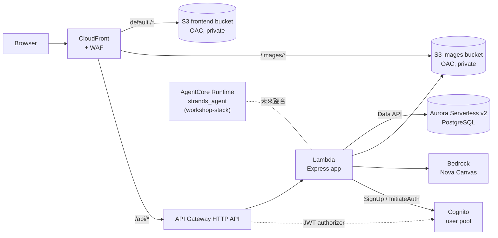

# Inventrix 架構評估與 Serverless 遷移建議

> 盤點日期：2026-11-13｜帳號：471112531231｜區域：us-east-1｜身分：`WSParticipantRole`（Workshop Studio 活動帳號）

## 1. 帳號現況

### 1.1 資源歸屬

帳號上的資源幾乎全部由一個 CloudFormation stack 管理。這個 stack 是 Workshop Studio 部署的，不是我們建立的。

| 歸屬                           | 內容                                                                                | 處理方式                                 |
| ------------------------------ | ----------------------------------------------------------------------------------- | ---------------------------------------- |
| `workshop-stack`（289 個資源） | 工作坊 IDE、AIDLC Platform、AgentCore、ECS 範例應用、VPC                            | 已轉成 `infra/` 的 CDK 程式碼，zero-diff |
| Workshop Studio 管理           | `WS*` IAM roles、`WSConcurrencyCurtailer-DO-NOT-USE` Lambda、`EEOrganizations` role | 不納入，屬於活動平台                     |
| 手動建立                       | Secrets Manager `aidlc/kiro`                                                        | 未納入，見 1.4                           |
| 帳號預設                       | default VPC `172.31.0.0/16`                                                         | 不納入                                   |

### 1.2 `workshop-stack` 的組成

| 子系統         | 主要資源                                                                                                                                                                                                                          |
| -------------- | --------------------------------------------------------------------------------------------------------------------------------------------------------------------------------------------------------------------------------- |
| 網路           | VPC `retail-store-vpc`（`10.0.0.0/16`）、4 個 subnet、2 個 NAT Gateway                                                                                                                                                            |
| 工作坊 IDE     | ASG（1 台 `m7i.xlarge`）、EFS home、CloudFront `d37srotu9n2m04.cloudfront.net`                                                                                                                                                    |
| AIDLC Platform | Cognito `agentcore-user-pool`、SPA（S3 + CloudFront `dl1k1zrnd3sn9.cloudfront.net`）、REST API `agentcore-strands-integration-config-api` 與約 20 個 Lambda、EFS projects storage、2 個 ECR repo、2 個 CodeBuild project、KMS key |
| AgentCore      | Runtime `strands_agent`（READY）、Gateway `agentcore-context-gateway`（READY）、2 個 GatewayTarget                                                                                                                                |
| ECS 範例       | Fargate cluster `ecs-sample-cluster`（`catalog`、`ui`、`loadgen`）、外部與內部 ALB、Cloud Map namespace                                                                                                                           |
| 其他           | CodeCommit `aidlc-workshop`、Bedrock 呼叫 log bucket、access log bucket                                                                                                                                                           |

AgentCore Runtime 與 Gateway 雖然是 custom resource 觸發 CodeBuild 建立，但它們的 physical ID 都在 stack 內，所以已經在 CloudFormation 管理之下。

### 1.3 Inventrix 目前沒有部署

帳號上沒有 Inventrix 的任何資源。它的既有部署方式是手動執行 `inventrix-code/deploy.sh`：

- 一台 EC2（預設 `t3.small`），PM2 常駐 Express API，nginx 以自簽憑證提供前端 `dist/`，並反向代理 `/api`、`/images`。
- 資料存在 instance 本機的 SQLite 檔 `inventrix.db`；商品圖片存在本機 `public/images/`。
- Security group 只開放部署者 IP 的 22、80、443、3000。
- 沒有 IaC、備份、監控或 CI/CD。

### 1.4 尚未納入程式碼的資源

`aidlc/kiro` 這個 secret 不屬於任何 stack，看起來是有人手動建立的個人憑證。建議不要把它匯入 IaC：匯入只會讓 secret 的生命週期綁到 stack 上，沒有實際好處。若之後的程式需要它，用 `Secret.fromSecretNameV2()` 參照即可。

## 2. 既有資源 IaC 化

### 2.1 做法

`infra/` 以 CDK `CfnInclude` 載入線上 `workshop-stack` 的原始 template：

- `templates/workshop-stack.template.json`：由 `pnpm export-template` 從線上 stack 匯出。
- 原 template 有 3 處寫死的測試帳號密碼。匯出腳本把它們換成 `<redacted:WORKSHOP_TEST_USER_PASSWORD>`；synth 時由 `scripts/with-live-password.sh` 從 stack output 讀回，所以密碼不會進 git。
- 使用 `LegacyStackSynthesizer` 並關閉 analytics reporting，synth 結果不會多出 bootstrap rule 或 `CDKMetadata`。
- 所有 logical ID 保留原樣。

沒有選 `cdk migrate --from-stack`：template 約 930 KB，含 23 個 custom resource。`cdk migrate` 會產出極大量的 L1 程式碼，卻不會比 `CfnInclude` 更容易修改；`CfnInclude` 仍能用 `getResource()` 取得任一資源做 override。

### 2.2 驗證結果

```bash
cd infra
AWS_PROFILE=aidlc-workshop pnpm diff
# Stack workshop-stack (aws://471112531231/us-east-1)
# There were no differences
```

`pnpm diff` 帶 `--no-change-set`，只讀取線上 template 比對，不會在 `workshop-stack` 上建立 change set。

### 2.3 使用限制

- **不要部署 `workshop-stack`**。它是活動平台，由 Workshop Studio 擁有；把它納入程式碼只是為了版本化與比對。
- **不要把它的資源匯入另一個 stack**。一個資源只能屬於一個 stack；要匯入就得先把它從 `workshop-stack` 移除，等於修改平台。
- 帳號沒有 CDK bootstrap（`CDKToolkit`）。之後部署 Inventrix 的新 stack 前要先 bootstrap；`workshop-stack` 的 template 超過 51 KB，若真要部署也需要 bootstrap bucket。

### 2.4 對 `workshop-stack` 的觀察

這些只是記錄，不建議我們去改：

- `AIDLCPlatformAuthAutoConfirmFn` 使用 `nodejs20.x`。這個 runtime 已在 2026-04-30 deprecated，2027-02-01 起無法建立新函式。
- Template 930 KB，接近 CloudFormation 1 MB 上限，平台方之後很難再加資源。
- 2 個 NAT Gateway 與持續執行的 ECS `loadgen` 是這個帳號的主要固定成本。

## 3. 目標架構

### 3.1 架構圖



<!-- Text fallback: The browser talks only to CloudFront, which has WAF attached. CloudFront's default behavior serves the SPA from a private S3 frontend bucket through Origin Access Control. The /images/* behavior serves product images from a private S3 images bucket. The /api/* behavior forwards to an API Gateway HTTP API, which proxies to one Lambda running the Express app. The Lambda reads and writes Aurora Serverless v2 PostgreSQL through the RDS Data API, writes generated images to the images bucket, calls Bedrock Nova Canvas, and calls the Cognito user pool for sign-up and sign-in. API Gateway validates Cognito ID tokens with a JWT authorizer before protected routes reach the Lambda. The AgentCore Runtime stays in workshop-stack and can be integrated later. -->

前端只透過同一個 CloudFront 網域呼叫 `/api` 與 `/images`。前端程式碼不需要改 API base URL，也不需要 CORS，這符合「前端只用相對路徑」的專案規則。

### 3.2 前端：S3 + CloudFront

- S3 bucket 封鎖公開存取，只允許 CloudFront OAC 讀取；CloudFront 只接受 HTTPS，HTTP 一律轉址。
- **SPA 路由的 fallback 要用 CloudFront Function，不要用 custom error response。** custom error response 對整個 distribution 生效，會把 `/api/*` 的 403、404 也換成 `index.html`，前端就收不到正確的 API 錯誤。CloudFront Function 只掛在 default behavior，把沒有副檔名的路徑改寫成 `/index.html`。
- `index.html` 設 `no-cache`；Vite 產出的 `assets/*` 檔名帶 hash，設一年的 `immutable` 快取。
- 部署用 CDK `BucketDeployment`，部署後 invalidate `/index.html`。

### 3.3 後端：API Gateway + Lambda

**建議用一個 Lambda 跑整個 Express app（Lambdalith）**，以 `@codegenie/serverless-express` 或 Lambda Web Adapter 包裝。

| 方案                           | 優點                                                      | 缺點                                            |
| ------------------------------ | --------------------------------------------------------- | ----------------------------------------------- |
| 單一 Lambda 跑 Express（建議） | 程式碼幾乎不用改，本機仍可 `pnpm dev`；只有一個函式要維護 | 冷啟動載入整個 app；IAM 權限是所有 route 的聯集 |
| 每個 route 一個 Lambda         | 權限與記憶體可個別調整，冷啟動較小                        | 要拆掉 Express router，改動大；PoC 不划算       |

API Gateway 選 **HTTP API**：比 REST API 便宜約 70%，延遲較低。REST API 多出的 usage plan、request validation 這次用不到；WAF 掛在 CloudFront 上即可。

遷移時一定要處理的問題：

| 現況                                   | 在 Lambda 上的問題                         | 處理方式                                                        |
| -------------------------------------- | ------------------------------------------ | --------------------------------------------------------------- |
| `express-rate-limit` 存在記憶體        | 每個 Lambda 執行環境各算各的，限流形同虛設 | 改用 API Gateway throttling，加上 WAF rate-based rule           |
| `JWT_SECRET` 有寫死的 fallback         | 環境變數漏設時會用公開的預設值簽 token     | 改由 Cognito 簽發 token，見 3.6                                 |
| 圖片寫入 `process.cwd()/public/images` | Lambda 只有 `/tmp` 可寫，且不會保留        | 寫進 S3 images bucket，回傳的 URL 格式維持 `/images/<name>.png` |
| `better-sqlite3` 是 native module      | Lambda 打包要針對 Amazon Linux 編譯        | 改用 Aurora 後直接移除                                          |
| Nova Canvas 生圖約需數秒到十幾秒       | HTTP API 整合上限 30 秒                    | Lambda timeout 設 29 秒；若常逾時，再改成非同步（S3 + 輪詢）    |

### 3.4 資料庫：Aurora Serverless v2 或 RDS

| 方案                                                      | 網路                                                                            | 連線管理                          | 成本特性                                    | 適合                                                      |
| --------------------------------------------------------- | ------------------------------------------------------------------------------- | --------------------------------- | ------------------------------------------- | --------------------------------------------------------- |
| **A. Aurora Serverless v2 PostgreSQL + Data API**（建議） | Lambda 不進 VPC，不需要 NAT                                                     | Data API 走 HTTPS，沒有連線池問題 | 最低容量可設 0 ACU 自動暫停，閒置只付儲存費 | PoC、低流量、不穩定流量                                   |
| B. RDS PostgreSQL（`db.t4g.micro`）+ RDS Proxy            | Lambda 要進 VPC，需要 VPC endpoint 或 NAT 才能呼叫 Bedrock、S3、Secrets Manager | RDS Proxy 管連線池                | 固定 instance 費用，加上 RDS Proxy 費用     | 流量穩定、需要 PostgreSQL 完整功能                        |
| C. Aurora DSQL                                            | Lambda 不進 VPC                                                                 | IAM 驗證                          | 完全依用量計費                              | 不建議：不支援 foreign key 等功能，現有 schema 要改寫更多 |

建議 A 的理由：

- 不必讓 Lambda 進 VPC，省掉 NAT Gateway（每個每月約 $33 起）與 VPC endpoint 的費用和設定。
- Data API 原生支援 transaction（`BeginTransaction`、`CommitTransaction`），可以順便修正下單流程沒有 transaction 的問題。
- 0 ACU 自動暫停後，第一個請求要等 cluster 恢復，約十幾秒。PoC 可以接受；正式環境建議最低容量設 0.5 ACU。

Aurora cluster 放在 Inventrix 自己的 VPC，只用 isolated subnet，不要放進 `retail-store-vpc`，避免和 `workshop-stack` 互相綁住。

從 SQLite 搬到 PostgreSQL 的實作決定（PoC 已採用）：

- **本機與雲端用同一種 SQL 方言。** Lambda 經 Data API 連 Aurora；本機 `pnpm dev` 改用 PGlite（WASM 版的嵌入式 PostgreSQL，資料存在 `packages/api/.pglite/`）。本機不需要 Docker，也不需要 AWS 憑證。
- 兩邊共用 `src/db/` 的 `query` 與 `transaction` 介面，SQL 以 `$n::type` 撰寫並明確轉型。Data API 會把字串參數當 `varchar` 傳入，不轉型就無法寫進數字欄位。
- **為了維持 API 回傳格式不變**，金額欄位用 `DOUBLE PRECISION`，不用 `NUMERIC`：Data API 會把 `NUMERIC` 回傳成字串，前端就會收到 `"12.50"` 而不是 `12.5`。時間欄位用 `TIMESTAMP(0)`，回傳格式維持 SQLite 的 `YYYY-MM-DD HH:MM:SS`。正式環境若要改用 `NUMERIC`，需要同時調整前端。
- `order_items.product_id` 不加 foreign key。原本 SQLite 沒有啟用 foreign key，後台可以刪除已有訂單的商品；PostgreSQL 若加上 foreign key，這個操作會變成 500。
- 下單改在同一個 transaction 內完成，並以 `SELECT ... FOR UPDATE` 鎖住商品列：庫存不足時整筆 rollback，同一商品在一張訂單出現兩次也不會超賣。
- Schema 建立與 seed 在 Lambda 冷啟動時執行，以 `pg_advisory_xact_lock` 避免多個執行環境同時 seed。
- 密碼改由 Cognito 管理，users 表不再存密碼，`bcrypt` 一併移除。

### 3.5 AgentCore Runtime：續用

`strands_agent` Runtime 與 `agentcore-context-gateway` 屬於 `workshop-stack`，維持原狀。Inventrix 目前沒有呼叫它們。若之後要整合（例如商品描述生成、庫存問答），由 Inventrix 的 Lambda 以 IAM 呼叫 `InvokeAgentRuntime`，在 Inventrix 自己的 stack 裡授權，不修改 `workshop-stack`。

### 3.6 驗證：Cognito

需求是只要能以 email 和密碼註冊、登入，不做 email 驗證或 MFA。

- **前端不改。** Lambda 代理 `/api/auth/register` 與 `/api/auth/login`，分別呼叫 Cognito 的 `SignUp` 與 `InitiateAuth`（`USER_PASSWORD_AUTH`），回傳格式維持 `{ token, user }`，`token` 是 Cognito ID token。前端不需要 user pool ID，也符合「不新增部署時才設定的前端環境變數」的專案規則。
- **註冊後直接可以登入。** pre sign-up trigger 自動確認帳號並標記 email 已驗證，Cognito 不寄驗證信。密碼政策只要求至少 8 碼。
- **API Gateway 先驗證。** HTTP API 的 JWT authorizer 以 user pool 為 issuer、app client 為 audience。登入、註冊與 `GET /api/products`、`GET /api/products/{id}` 是公開路由。`/api/cart`、`/api/gomoku` 與 `POST /api/support/chat` 也開放給訪客，由 Lambda 的 `identify` 或 `optionalAuthenticate` middleware 依 token 判斷是否為登入使用者。其他 `/api/*` 都需要 token。Lambda 內以 `aws-jwt-verify` 再驗證一次：這是第二道防線，本機開發沒有 API Gateway 時也靠它。
- **角色。** 管理員是 Cognito `admin` group 的成員，Lambda 從 token 的 `cognito:groups` 判斷。管理員帳號由部署時的 custom resource 建立，密碼由 Secrets Manager 產生，不再使用寫在 repo 裡的示範密碼。
- **users 表。** 訂單以整數 `user_id` 關聯 users，所以每個 Cognito 帳號仍有一筆 users 資料列，以 `cognito_sub` 對應，第一次登入時建立。訂單與後台 API 的回傳格式不變。
- **取捨。** ID token 效期 1 天，不做 refresh，過期後前端收到 401 會自動登出。被 API Gateway 擋下的請求回傳 `{"message":"Unauthorized"}`，前端只會顯示通用的錯誤訊息。本機開發要連已部署的 user pool。

## 4. CDK stack 規劃

| Stack            | 內容                                                                                                                                                                    | 刪除政策                                                                             |
| ---------------- | ----------------------------------------------------------------------------------------------------------------------------------------------------------------------- | ------------------------------------------------------------------------------------ |
| `workshop-stack` | `CfnInclude` 既有平台，只做 diff，不部署                                                                                                                                | 不適用                                                                               |
| `inventrix`      | VPC（isolated subnet）、Aurora cluster、images bucket、DB 帳密、Cognito user pool 與管理員帳密、Lambda、HTTP API、frontend bucket、CloudFront、CloudFront Function、WAF | Aurora 為 `SNAPSHOT`；images bucket、user pool 與兩個 secret 為 `RETAIN`；其餘可重建 |

PoC 先用單一 stack。若把 images bucket 放在另一個 stack，CloudFront OAC 修改 bucket policy 時會造成跨 stack 循環相依，要額外處理。有狀態的資源都設了保留政策，所以刪除 stack 不會刪掉資料。正式環境建議拆成資料 stack 與應用 stack，讓應用 stack 可以放心重建。

## 5. 成本概估

以下以 us-east-1 公開價目、低流量（每月數萬個請求）粗估，未含稅與資料傳輸，實際以 AWS Pricing Calculator 為準。

| 項目       | 現行 `deploy.sh`                    | 目標架構                                                 |
| ---------- | ----------------------------------- | -------------------------------------------------------- |
| 運算       | EC2 `t3.small` 約 $15／月，另加 EBS | Lambda、API Gateway 在此流量下接近免費額度               |
| 資料庫     | 含在 EC2 內                         | Aurora 自動暫停時只付儲存費；最低 0.5 ACU 常駐約 $44／月 |
| 前端與圖片 | 含在 EC2 內                         | S3 與 CloudFront 每月數美元以內                          |
| WAF        | 無                                  | 約 $5／月，加上每條規則 $1                               |

PoC 的成本主要取決於 Aurora 是否允許自動暫停。

## 6. 從 PoC 到正式環境還缺什麼

- **CI/CD**：目前沒有 pipeline。建議 GitHub Actions 以 OIDC 取得 AWS 權限，PR 跑 `cdk diff`，merge 後部署。
- **監控**：Lambda 錯誤率與 p95 延遲、API Gateway 5xx、Aurora ACU 用量的 CloudWatch alarm。
- **驗證機制**：已改用 Cognito，但 ID token 仍存在 `localStorage`，容易被 XSS 竊取，也沒有 refresh 與撤銷機制。正式環境可加上 refresh token，或改用 httpOnly cookie。
- **自訂網域**：ACM 憑證（必須在 us-east-1）加上 Route 53。
- **多環境**：以 CDK stage 區分 dev 與 prod，各自一組 stack。
- **資料遷移**：目前沒有正式資料，seed 即可；若之後有 SQLite 正式資料，需要一次性的匯出匯入腳本。
- **API 只能經 CloudFront 存取**：目前 `execute-api` 網域仍可直接呼叫，會繞過 WAF。可以讓 CloudFront 帶一個秘密 header，由 Lambda 驗證，或改用 REST API 搭配 resource policy。

## 7. 部署方式

```bash
cd infra
AWS_PROFILE=aidlc-workshop pnpm diff               # 先看差異
AWS_PROFILE=aidlc-workshop pnpm deploy:inventrix   # build 前端，再部署 inventrix stack
```

`deploy:inventrix` 會先 build `packages/frontend`，CDK 再把 `dist/` 上傳到 S3 並 invalidate CloudFront。Lambda 由 CDK 以 esbuild 打包 `packages/api/src/lambda.ts`。每次部署前都先看 `pnpm diff`。
